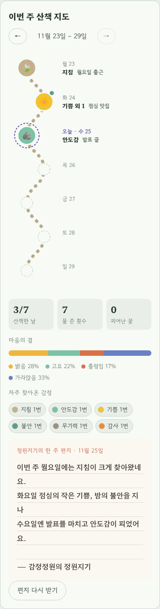

# 감정정원 🌱

오늘의 마음을 적으면 정원지기가 감정을 읽고 어울리는 씨앗을 골라줘요.
하루에 한 번 물을 주면 씨앗이 사흘에 걸쳐 꽃으로 자라고, 정원은 하늘에 떠 있는 미니어처 섬 위에서 조금씩 넓어져요.

## 어떻게 놀아요

1. **오늘의 산책**: 오늘 있었던 일과 마음을 편하게 적어요.
2. **감정 읽기**: 정원지기(AI)가 감정 40종 중 1~3개와 세기(1~5)를 고르고, 일기와 따뜻한 한마디를 만들어줘요. AI 없이 감정을 직접 고를 수도 있어요.
3. **씨앗 심기**: 주된 감정이 씨앗의 종류와 색을 정해요.
4. **물 주기**: 하루 한 번 물을 주면 씨앗 → 새싹 → 꽃봉오리 → 꽃으로 자라요. 시들지 않아요.
5. **둘러보기**: 섬을 돌려 보고, 식물을 누르면 그날의 일기가 다시 열려요.
6. **산책하기**: 작아져서 정원 안을 걸어요. 폰은 왼쪽 아래 조이스틱, 컴퓨터는 WASD·방향키로 걷고 화면을 끌어서 둘러봐요. 식물 가까이 가면 일기 보기와 물 주기를 할 수 있어요. (Esc: 섬 위로 돌아가기)

## 그래픽


코드만으로 그린 3D예요. ACES 톤 매핑, 캔버스로 그린 잔디·흙·돌 질감, 인스턴싱한 풀잎, 석등·반딧불·물방울·편지·밤 꽃의 빛 번짐 스프라이트를 써요. 폰에서 초당 32프레임이 안 나오면 해상도와 그림자를 자동으로 낮춰요.

## 계절


정원은 실제 달을 따라 계절이 바뀌어요. 봄 3~5월, 여름 6~8월, 가을 9~11월, 겨울 12~2월. 3D 정원 오른쪽 위 계절 버튼으로 바꿔 볼 수도 있어요.

## 이번 주 산책 지도



월요일부터 일요일까지를 산책길 지도로 보여줘요. 정류장마다 그날의 주된 감정 색과 꽃이 찍히고, 누르면 그날 일기가 열려요. 마음의 결은 감정을 밝음(둥근꽃·꽃봉오리), 고요(이끼돌), 출렁임(고사리·가시풀), 가라앉음(초롱꽃·버들풀)으로 묶어 세기만큼 비율을 보여줘요.

## 음악

"🎵 음악 켜기"를 누르면 브라우저가 그 자리에서 잔잔한 배경음악을 연주해요(Web Audio, 음원 파일 없음).

- 계절마다 조성이 달라요: 봄 C장조, 여름 D장조 펜타토닉, 가을 A단조 펜타토닉, 겨울 E 리디안 느낌
- 밤에는 음이 낮아지고 성겨져요
- 자연 소리: 낮에는 새소리, 밤에는 풀벌레, 가을엔 약한 바람, 겨울엔 바람
- 효과음: 씨앗 심기, 물 주기, 꽃 피기, 편지 도착

## 감정과 식물

| 식물 | 마음 | 감정 |
|---|---|---|
| 둥근꽃 | 따뜻하게 차오르는 마음 | 기쁨, 만족, 감사, 감격, 사랑, 황홀 |
| 꽃봉오리 | 앞을 바라보는 마음 | 설렘, 자존감, 감탄, 경외, 기대, 희망, 호기심 |
| 초롱꽃 | 고개 숙인 마음 | 외로움, 슬픔, 후회, 그리움, 향수, 연민, 수치심, 죄책감, 공감적 고통 |
| 고사리 | 흔들리는 마음 | 불안, 난처함, 초조, 혼란 |
| 가시풀 | 날이 선 마음 | 분노, 짜증, 질투, 부러움, 혐오 |
| 이끼돌 | 가라앉은 고요 | 평온, 신뢰, 안도감 |
| 버들풀 | 기운이 빠진 마음 | 공허, 지침, 무기력, 번아웃, 지루함 |
| 새싹 | 아직 이름 없는 마음 | 미확인 |

감정 번호(01~40)는 "하루 10분 감정산책" 감정 목록을 따라요.

## 지금 실행되는 곳

현재는 **claude.ai 아티팩트**로 실행해요. 아티팩트 안에서는 다음 기능을 써요.

| 기능 | 아티팩트 안 | 브라우저에서 `index.html`을 바로 열 때 |
|---|---|---|
| 기록 저장 | claude.ai 계정의 개인 저장 공간 (`db`) | 이 브라우저의 localStorage |
| 감정 읽기 | Claude (`sample`) | 사용 불가 → 감정 직접 고르기 |
| 백업 파일 받기 | `downloads` | 숨겨짐 |
| 백업 불러오기 | 사용 가능 | 사용 가능 |

3D 정원은 [three.js](https://threejs.org/) r128(jsDelivr CDN)을 써요. WebGL을 쓸 수 없으면 2D 정원으로 바뀌어요.

## 백업 파일 형식

```json
{
  "app": "감정정원",
  "version": 1,
  "exportedAt": "2026-11-25T12:00:00.000Z",
  "entries": [
    {
      "id": "pmkx1a2b3",
      "date": "2026-11-25",
      "createdAt": 1795600000000,
      "emotions": [{ "n": 15, "s": 4 }, { "n": 8, "s": 2 }],
      "title": "할머니 생각",
      "diary": "정원지기가 다듬은 일기",
      "note": "정원지기의 한마디",
      "original": "내가 처음 쓴 글",
      "waterDays": ["2026-11-25", "2026-11-26"],
      "letter": { "text": "정원지기의 편지", "at": 1795900000000, "read": false, "ai": true }
    }
  ],
  "weeks": {
    "week-2026-11-23": { "text": "정원지기의 한 주 편지", "at": 1795900000000, "ai": true }
  }
}
```

- `emotions[].n`: 감정 번호(1~40), `s`: 세기(1~5). 첫 번째가 주된 감정이에요.
- `letter`: 꽃이 피었을 때 받은 편지. `ai`가 false면 AI 없이 쓴 기본 편지예요. 없으면 편지를 아직 안 받은 거예요.
- `weeks`: 한 주 편지. 키는 `week-` 뒤에 그 주 월요일 날짜예요.
- `waterDays`: 물 준 날짜. 심은 날이 첫 번째이고, 성장 단계는 `waterDays.length - 1`(최대 3)이에요. 없으면 다 핀 꽃으로 봐요.

## 앞으로

- [x] 배경음악과 효과음
- [x] 전체 화면 모드: 3D 정원 오른쪽 위 "⛶ 크게"로 폰 화면 가득 보기
- [x] 그래픽 다듬기 1단계: 톤 매핑, 빛 번짐, 질감, 빽빽한 풀, 떠 있는 바위섬과 구름
- [ ] 그래픽 2단계: AI 3D 생성 도구로 만든 모델(.glb)로 꽃과 소품 바꾸기

- [x] 산책 모드: 징검다리나 "정원 안으로 산책하기"를 누르면 섬 안으로 들어가 1인칭으로 걷기
- [x] 계절 변화: 실제 달을 따라 봄(벚꽃·꽃잎), 여름(초록·홀씨), 가을(단풍·낙엽), 겨울(눈)
- [x] 정원지기의 편지: 꽃이 피면 그날의 일기와 돌본 시간을 돌아보는 편지가 와요. 섬의 우체통(새 편지가 오면 빨간 깃발)과 편지함에서 읽어요.
- [x] 이번 주 산책 지도: 월~일 산책길 지도, 산책한 날·물 준 횟수·피어난 꽃, 마음의 결, 자주 찾아온 감정, 정원지기의 한 주 편지
- [ ] 독립 웹사이트로 옮기기: 구글 로그인(Firebase Auth), 저장(Firestore), AI 감정 읽기 서버. 백업 파일을 불러와 정원을 그대로 옮겨요.
