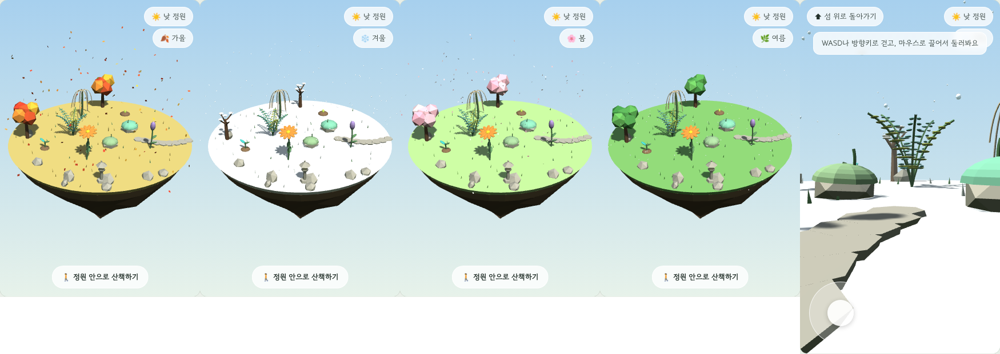
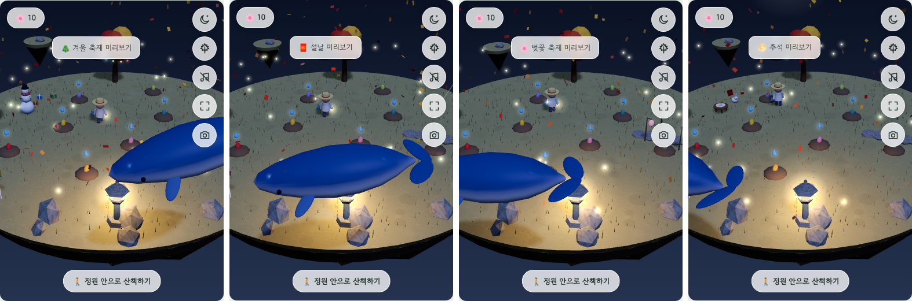
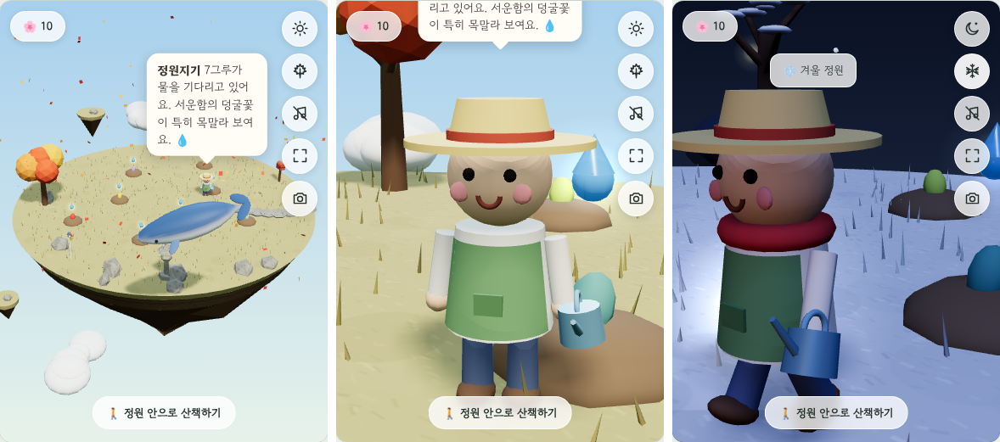
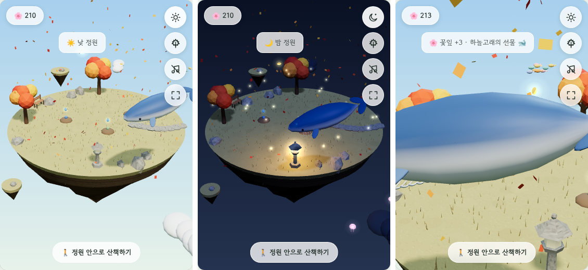
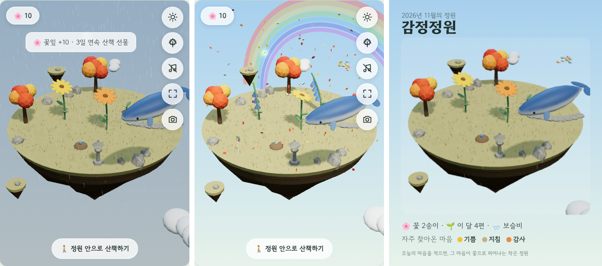
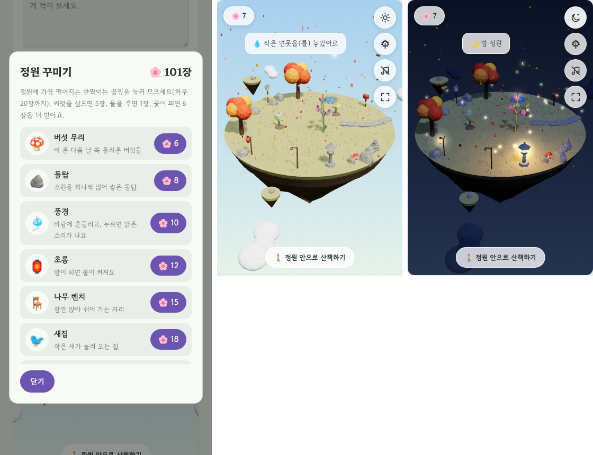
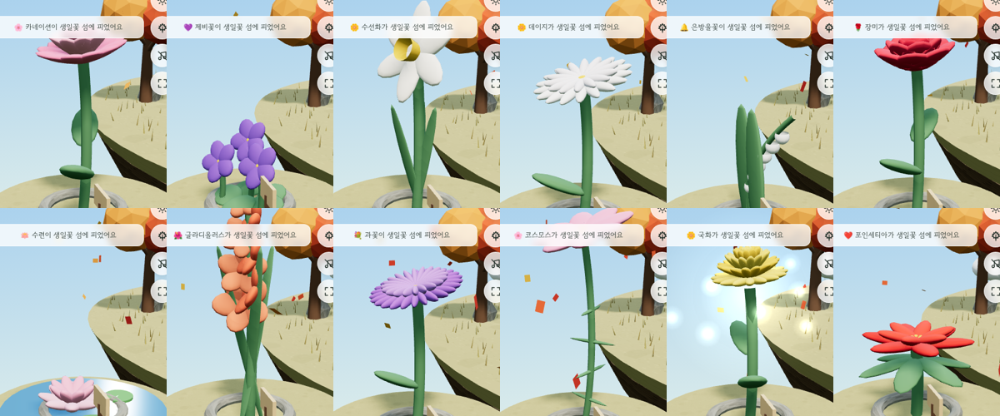
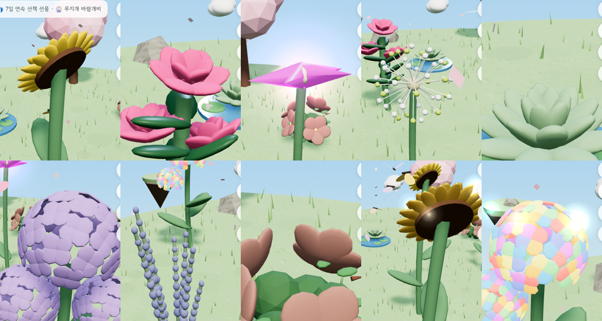

# 🌱 감정정원
**오늘의 마음을 적으면, 그 마음이 꽃으로 피어나는 작은 정원**



감정정원은 하루 한 번 내 마음을 들여다보는 힐링 감정 일기 게임이에요.
잘 쓰려고 애쓰지 않아도 괜찮아요. 오늘 있었던 일을 떠오르는 대로 적기만 하면 돼요.

**👉 바로 해 보기: https://u-el.github.io/emotion-garden/** (로그인 없이 열려요. 정원은 쓰는 기기에 저장돼요)

## 이렇게 놀아요
**✍️ 마음을 적어요**
오늘 있었던 일과 느낌을 편하게 적으면, 정원지기가 그 안의 감정을 51가지 감정 중에서 읽어내고 따뜻한 한마디를 건네요.

**🌰 씨앗을 심어요**
감정마다 어울리는 식물이 있어요. 기쁨은 둥근꽃, 슬픔은 초롱꽃, 불안은 고사리, 서운함은 덩굴꽃. 마음이 강할수록 크게 자라요.

**💧 매일 물을 줘요**
하루 한 번 물을 주면 씨앗 → 새싹 → 꽃봉오리 → 꽃으로 자라요. 시들지 않으니 며칠 쉬어도 괜찮아요.

**✉️ 편지를 받아요**
꽃이 피면 정원지기가 그날의 마음을 돌아보는 편지를 보내요. 섬의 우체통에 깃발이 올라가면 새 편지가 온 거예요.

## 작은 즐거움들
- 🏝️ **하늘에 떠 있는 미니어처 섬:** 손가락으로 돌려 보고, 꽃을 누르면 그날의 일기가 다시 열려요
- 🚶 **정원 산책:** 섬 안으로 들어가 꽃 사이를 직접 걸어요
- 🌸 **계절과 시간:** 봄엔 벚꽃잎, 겨울엔 눈이 내리고, 밤에는 반딧불과 석등이 정원을 밝혀요
- 🎐 **정원 꾸미기:** 떨어지는 반짝이는 꽃잎을 모아 풍경, 초롱, 연못, 꽃 아치로 섬을 꾸며요
- 🗺️ **이번 주 산책 지도:** 한 주의 감정 흐름을 산책길 지도로 돌아봐요
- 🎂 **나의 생일꽃:** 생일 달의 탄생화가 작은 섬에 피고, 생일엔 특별한 편지가 와요
- 🎵 **잔잔한 음악:** 계절과 시간에 따라 달라지는 음악과 새소리, 풀벌레 소리

## 이런 분께 추천해요
- 하루를 마무리하며 내 마음을 정리하고 싶은 분
- 일기는 쓰고 싶은데 매번 막막했던 분
- 경쟁이나 점수 없이 천천히 쉬어 가는 게임을 찾는 분

어떤 마음이든 이 정원에서는 꽃이 될 수 있어요.
오늘의 마음, 하나 심어 볼까요? 🌱

## 플레이하기
👉 **[감정정원 열기](https://claude.ai/artifact/FUtZYwvSzMsfQiYWgWauB1)**

claude.ai에 로그인하면 정원지기가 감정을 읽어주고 기록이 계정에 저장돼요. 로그인 없이도 감정을 직접 골라 정원을 가꿀 수 있어요(기록은 그 브라우저에만 남아요).

---

# 자세히 보기

## 조작법

1. **오늘의 산책**: 오늘 있었던 일과 마음을 편하게 적어요.
2. **감정 읽기**: 정원지기(AI)가 감정 51종 중 1~3개와 세기(1~5)를 고르고, 일기와 따뜻한 한마디를 만들어줘요. AI 없이 감정을 직접 고를 수도 있어요.
3. **씨앗 심기**: 주된 감정이 씨앗의 종류와 색을 정해요.
4. **물 주기**: 하루 한 번 물을 주면 씨앗 → 새싹 → 꽃봉오리 → 꽃으로 자라요. 시들지 않아요.
5. **둘러보기**: 섬을 돌려 보고, 식물을 누르면 그날의 일기가 다시 열려요.
6. **산책하기**: 정원 안을 걸어요. 눈높이는 👀 버튼으로 낮게(풀잎 사이), 보통(꽃 높이), 높게(내려다보기) 중에 골라요. 폰은 왼쪽 아래 조이스틱, 컴퓨터는 WASD·방향키로 걷고 화면을 끌어서 둘러봐요. 식물 가까이 가면 일기 보기와 물 주기를 할 수 있어요. (Esc: 섬 위로 돌아가기)

## 그래픽


코드만으로 그린 3D예요. ACES 톤 매핑, 캔버스로 그린 잔디·흙·돌 질감, 인스턴싱한 풀잎, 석등·반딧불·물방울·편지·밤 꽃의 빛 번짐 스프라이트를 써요. 폰에서 초당 32프레임이 안 나오면 해상도와 그림자를 자동으로 낮춰요.

## 계절 행사와 정원지기와의 대화



- **계절 행사**: 날짜에 맞춰 정원에 장식이 생겨요. 12월 겨울 축제(눈사람, 선물 상자, 나무를 감은 반짝이 전구와 별), 설날(나무의 복주머니, 하늘의 방패연), 4월 1~14일 벚꽃 축제(산책길 꽃등), 추석(커다란 보름달, 송편 상, 달토끼). 설날과 추석은 음력이라 그날 앞 3일부터 뒤 2일까지 열려요. "🎉 행사 미리보기"로 미리 볼 수 있어요.
- **정원지기와 이야기**: 정원지기 말풍선의 "💬 이야기하기"나 "💬 정원지기와 이야기"로 짧게 대화해요. 정원지기는 최근 일기와 정원 상태를 알고 존댓말로 2~4문장 답해요. 진단이나 처방은 하지 않고, 위험한 표현이 나오면 상담전화를 안내해요. 대화는 저장되지 않아요. AI를 쓸 수 없을 때는 마음 단어로 짧게 답해요.

## 정원지기



밀짚모자에 초록 앞치마를 두르고 물뿌리개를 든 정원지기가 섬을 돌아다녀요. 물이 필요한 식물 옆에 가서 💧로 알려주고(물은 직접 주지 않아요), 핀 꽃 앞에서 몸을 숙여 들여다봐요. 밤엔 등불, 비 오는 날엔 우산, 겨울엔 빨간 목도리를 해요. 누르면 물 줄 식물, 새 편지, 마음 날씨, 연속 산책, 생일 같은 그날의 이야기를 말풍선으로 들려줘요.

## 하늘 친구들



- 🐋 **하늘고래**가 섬 위를 천천히 돌며 헤엄쳐요. 밤에는 몸의 빛 점이 반짝여요. 누르면 고래 노래가 들리고, 하루 한 번 꽃잎 3장을 선물해요.
- 🐟 낮에는 작은 **하늘 물고기 떼**가 섬 둘레를 돌아요.
- 🪼 밤에는 빛나는 **해파리**들이 아래에서 천천히 떠올라요.

## 계절


정원은 실제 달을 따라 계절이 바뀌어요. 봄 3~5월, 여름 6~8월, 가을 9~11월, 겨울 12~2월. 3D 정원 오른쪽 위 계절 버튼으로 바꿔 볼 수도 있어요.

## 이번 주 산책 지도


월요일부터 일요일까지를 산책길 지도로 보여줘요. 정류장마다 그날의 주된 감정 색과 꽃이 찍히고, 누르면 그날 일기가 열려요. 마음의 결은 감정을 밝음(둥근꽃·꽃봉오리), 고요(이끼돌), 출렁임(고사리·가시풀), 가라앉음(초롱꽃·버들풀)으로 묶어 세기만큼 비율을 보여줘요.

## 음악

"🎵 음악 켜기"를 누르면 브라우저가 그 자리에서 잔잔한 배경음악을 연주해요(Web Audio, 음원 파일 없음).

- 계절마다 조성이 달라요: 봄 C장조, 여름 D장조 펜타토닉, 가을 A단조 펜타토닉, 겨울 E 리디안 느낌
- 밤에는 음이 낮아지고 성겨져요
- 자연 소리: 낮에는 새소리, 밤에는 풀벌레, 가을엔 약한 바람, 겨울엔 바람
- 효과음: 씨앗 심기, 물 주기, 꽃 피기, 편지 도착

## 마음 날씨와 정원 사진



- **마음 날씨**: 최근 사흘의 감정으로 정원 날씨가 정해져요. 밝은 마음이면 맑음, 섞여 있으면 구름 조금, 무거운 날이 이어지면 보슬비(빗소리 포함), 비 온 뒤 마음이 개면 무지개가 떠요. "나의 정원" 옆에 오늘의 마음 날씨가 보여요.
- **정원 사진**: 📷 버튼으로 지금 보이는 정원을 사진 카드(1080×1350)로 만들어요. 이달의 꽃, 일기 수, 마음 날씨, 자주 찾아온 마음이 함께 들어가요. 오른쪽 위에는 감정정원으로 바로 오는 QR 코드가, 아래에는 주소가 들어가서 친구에게 사진만 보내도 놀러 올 수 있어요.
- **나비와 새**: 꽃이 핀 만큼(최대 8마리) 나비가 꽃 사이를 날아다니고, 새집마다 새가 주위를 돌아요. 밤, 겨울, 비 오는 날에는 쉬어요.
- **한 달 편지**: 감정 달력 아래에서, 한 달에 일기가 3편 넘게 쌓이면 정원지기의 한 달 편지를 받아요.
- **마음 단어로 감정 읽기**: AI를 쓸 수 없을 때(로그인하지 않았을 때 등)는 51가지 감정의 마음 단어 사전으로 감정을 골라줘요. "너무, 정말" 같은 말은 세기를 올리고, "안, 못"이 앞에 오면 덜 세게 봐요.
- **일기장 내보내기**: 기록 보관함에서 모든 일기를 날짜순 텍스트 파일로 저장해요(감정, 질문, 한마디, 꽃 편지 포함). 파일로 저장할 수 없는 화면에서는 복사할 수 있게 보여줘요.

## 일기장과 감정 달력

- **나의 일기장**: 지금까지의 일기를 최신순으로 보고, 제목·내용·감정 이름으로 찾아요. 찾은 글자는 형광펜으로 표시돼요.
- **일기 고치기**: 식물을 눌러 "고치기"로 제목, 일기, 감정(세기 포함)을 고쳐요. 첫 번째 감정을 바꾸면 식물도 바뀌어요.
- **감정 달력**: 한 달을 달력으로 보고, 날마다 그날 가장 강한 감정의 색과 식물 아이콘이 칠해져요. 날짜를 누르면 그날 일기가 열려요.

## 오늘의 질문

일기 쓰기가 막막한 날을 위해 정원지기가 매일 다른 질문(40가지)을 건네요. "이 질문에 답하기"를 누르면 질문이 일기와 함께 저장되고, 정원지기도 질문을 알고 감정을 읽어요.

## 연속 산책과 숨은 찾기

- 씨앗을 심거나 물을 준 날이 이어지면 "👣 n일 연속"이 표시돼요.
- 3일 연속: 꽃잎 10장 · 7일 연속: 🎡 무지개 바람개비 · 14일 연속: 꽃잎 30장 · 30일 연속: 🌟 별빛 나무 (선물은 한 번씩)
- 산책 모드에서는 매일 섬 어딘가에 🍀 네잎클로버(꽃잎 +3)와 📜 쪽지(꽃잎 +2, 정원지기의 짧은 글)가 숨어 있어요. 가까이 걸어가거나 눌러서 주워요(너무 멀면 "조금 더 가까이 가 보세요"라고 알려줘요).

## 처음 온 사람 안내와 마음 안전

- 처음 방문하면 세 장짜리 안내가 떠요. 머리말 아래 "처음이라면? 안내 보기"로 다시 볼 수 있어요.
- 일기에 자해나 자살과 관련된 표현이 보이면, AI가 없어도 일기 창과 식물 창에 도움받을 수 있는 곳(자살예방상담전화 109, 정신건강위기상담 1577-0199, 청소년상담 1388, 긴급 119·112)을 조용히 보여줘요.

## 꽃잎 모아 정원 꾸미기



- 정원에 가끔 반짝이는 꽃잎(봄 벚꽃잎, 여름 홀씨, 가을 금빛 잎, 겨울 눈 결정)이 떨어져요. 눌러서 모아요(하루 20장까지).
- 씨앗 심기 +5(하루 2번까지), 물 주기 +1, 꽃 피우기 +6
- 모은 꽃잎으로 버섯 무리(6), 돌탑(8), 풍경(10), 초롱(12), 나무 벤치(15), 새집(18), 작은 연못(25), 꽃 아치(30)를 사요. 작은 소품은 5개, 큰 소품(벤치, 새집, 연못, 꽃 아치)은 3개, 선물 소품은 1개까지예요.
- 산 소품은 섬을 눌러 원하는 자리에 놓아요(컴퓨터에서는 마우스를 따라 미리보기가 움직여요). 놓인 소품을 누르면 옮기기, 돌리기(45도씩), 치우기를 할 수 있고, 치운 소품은 상점의 "놓기"로 다시 놓아요.

## 첫 씨앗

처음 심는 씨앗은 3분 뒤에 저절로 새싹이 돋고, 물을 두 번 주면(이틀) 꽃이 펴요. 그다음 씨앗부터는 물 세 번(사흘)이에요.

## 생일꽃



"나의 생일꽃"에서 생일 달(과 날짜)을 고르면 그 달의 탄생화가 정원 옆 작은 생일꽃 섬에 피어요. 생일 달에는 꽃 주위가 반짝이고, 생일 당일에는 맨 위에 축하 배너와 정원지기의 생일 편지가 와요.

| 달 | 꽃 | 꽃말 |
|---|---|---|
| 1월 | 카네이션 | 사랑과 존경 |
| 2월 | 제비꽃 | 겸손과 성실 |
| 3월 | 수선화 | 새로운 시작 |
| 4월 | 데이지 | 순수와 희망 |
| 5월 | 은방울꽃 | 다시 찾은 행복 |
| 6월 | 장미 | 사랑과 아름다움 |
| 7월 | 수련 | 청순한 마음 |
| 8월 | 글라디올러스 | 굳은 결심 |
| 9월 | 과꽃 | 추억 |
| 10월 | 코스모스 | 조화 |
| 11월 | 국화 | 진실 |
| 12월 | 포인세티아 | 축복 |

## 감정과 식물



| 식물 | 마음 | 감정 |
|---|---|---|
| 🌻 해바라기 | 환하게 웃는 마음 | 기쁨, 즐거움, 감격 |
| 🌺 동백꽃 | 아끼고 고마운 마음 | 사랑, 감사 |
| 🌼 둥근꽃 | 따뜻하게 차오르는 마음 | 만족, 뿌듯함 |
| ✨ 별빛꽃 | 반짝이며 놀라는 마음 (밤에 스스로 빛나요) | 황홀, 감탄, 호기심 |
| 🌷 꽃봉오리 | 앞을 바라보는 마음 | 설렘, 자존감 |
| 🌾 민들레 | 가볍게 날아오르는 마음 | 홀가분함, 희망, 기대 |
| 🪷 연꽃 | 잔잔하게 가라앉은 마음 | 평온, 경외, 안도감 |
| 🪨 이끼돌 | 가라앉은 고요 | 신뢰 |
| 💠 수국 | 누군가를, 그때를 그리는 마음 | 그리움, 향수, 외로움 |
| 🔔 초롱꽃 | 고개 숙인 마음 | 슬픔, 후회, 연민, 수치심, 죄책감, 공감적 고통 |
| 💜 라벤더 | 조마조마한 마음 | 불안, 초조 |
| 🌿 고사리 | 흔들리는 마음 | 난처함, 혼란, 놀람, 두려움 |
| 🌹 들장미 | 누군가를 바라보는 마음 | 질투, 부러움 |
| 🌵 가시풀 | 날이 선 마음 | 분노, 짜증, 혐오, 억울함, 답답함 |
| 🍃 버들풀 | 기운이 빠진 마음 | 공허, 지침, 무기력, 번아웃, 지루함, 막막함 |
| 🪴 덩굴꽃 | 관계 속에서 생긴 마음 | 실망, 서운함, 아쉬움, 미안함 |
| 🌱 새싹 | 아직 이름 없는 마음 | 미확인 |

**희귀 꽃**: 씨앗을 심을 때 몰래 정해지고 꽃이 필 때 공개돼요. ✨ 금빛 꽃(세기 5인 감정은 30%, 그 밖에는 4%), 🌈 무지개 꽃(1.5%, 꽃잎마다 다른 색). 희귀 꽃이 피면 꽃잎 +5장을 더 받고, 감정 도감에 희귀 꽃 수가 기록돼요.

감정 번호 01~39는 "하루 10분 감정산책" 감정 목록을 따르고, 40~51은 감정정원에서 더한 감정(놀람, 두려움, 실망, 서운함, 억울함, 답답함, 아쉬움, 미안함, 뿌듯함, 즐거움, 홀가분함, 막막함), 52는 미확인이에요. v2 이전 기록에서 40은 미확인이라, 읽을 때 52로 바꿔 읽어요(`v` 필드가 2 이상이면 그대로).

## 개발 노트

### 파일 구조

```
index.html            화면 뼈대(마크업)와 스크립트 순서
css/style.css         모양(색, 글꼴, 배치, 밝은/어두운 테마)
js/01-data.js         감정 51종, 꽃 17종, 공통 도구
js/02-store.js        저장(claude.ai 계정 또는 이 브라우저), 백업, 쓰던 글 임시 저장
js/03-writing.js      감정 읽기(정원지기), 감정 고르기, 씨앗 심기, 희귀 꽃, 물 주기
js/04-letters.js      꽃 편지, 편지지, 생일꽃
js/05-decor.js        꽃잎 모으기, 정원 꾸미기 상점, 소품 놓기
js/06-journal.js      마음 안전 안내, 오늘의 질문, 일기장, 감정 달력, 연속 산책, 숨은 찾기, 첫 안내
js/07-extras.js       마음 날씨, 마음 단어 읽기, 한 달 편지, 일기장 내보내기, 정원 사진, 정원지기의 한마디
js/08-weekly.js       이번 주 산책 지도, 한 주 편지, 편지함
js/09-garden-2d.js    예시 정원, 3D를 쓸 수 없을 때의 2D 정원
js/10-3d-kit.js       3D 재료와 도구(재질, 질감, 빛 번짐, 줄기와 잎, 꽃잎 고리)
js/11-3d-plants.js    식물 17종과 희귀 꽃, 12달 생일꽃 모양
js/12-3d-decor.js     정원 꾸미기 소품 모양
js/13-3d-events.js    계절 행사(겨울 축제, 설날, 벚꽃 축제, 추석) 날짜와 장식
js/14-garden-3d.js    3D 섬: 섬, 하늘과 날씨, 하늘 친구들, 정원지기, 계절, 심기, 누르기, 산책 모드
js/15-music.js        배경음악, 자연 소리, 효과음
js/16-chat.js         정원지기와 이야기하기
js/17-main.js         화면 다시 그리기, 식물 창, 시작
tools/build_artifact.py   claude.ai에 올릴 한 파일짜리 페이지 만들기
tests/e2e.js          전체 기능 점검
```

- 스크립트는 번호 순서대로 불러오는 일반 `<script>`예요. 앞 파일에서 만든 이름(`E`, `entries`, `render` 등)을 뒤 파일에서 그대로 써요. 새 파일을 만들면 `index.html`의 순서에 맞춰 넣어 주세요.
- 3D는 three.js r128(jsDelivr)을 써요.

### 내 컴퓨터에서 열기

```bash
python3 -m http.server 8765      # 저장소 폴더에서
# 브라우저로 http://127.0.0.1:8765 열기
```

`index.html`을 파일로 바로 열면 스크립트를 못 불러오는 브라우저가 있어서, 작은 웹 서버로 여는 게 좋아요. claude.ai 밖에서는 기록이 그 브라우저에만 저장되고, 감정 읽기는 마음 단어 사전으로 해요.

### claude.ai 페이지 만들기

```bash
python3 tools/build_artifact.py   # dist/emotion-garden.html
```

claude.ai 아티팩트는 이 한 파일로 올려요(CSS와 스크립트를 순서대로 안에 넣어요).

### 점검

```bash
npm i --no-save playwright three@0.128.0
python3 -m http.server 8765 &
node tests/e2e.js
```

첫 안내, 감정 읽기, 심기, 백업 불러오기, 연속 산책 선물, 일기장 검색, 달력, 일기 고치기, 내보내기, 정원 사진, 하늘고래, 소품 사고 놓기, 음악, 산책 숨은 찾기, 생일꽃을 차례로 해 보고 오류가 없는지 확인해요.

## 지금 실행되는 곳

현재는 **claude.ai 아티팩트**로 실행해요. 아티팩트 안에서는 다음 기능을 써요.

| 기능 | 아티팩트 안 | 브라우저에서 `index.html`을 바로 열 때 |
|---|---|---|
| 기록 저장 | claude.ai 계정의 개인 저장 공간 (`db`) | 이 브라우저의 localStorage |
| 감정 읽기 | Claude (`sample`) | 사용 불가 → 감정 직접 고르기 |
| 백업 파일 받기 | `downloads` | 숨겨짐 |
| 백업 불러오기 | 사용 가능 | 사용 가능 |

3D 정원은 [three.js](https://threejs.org/) r128(jsDelivr CDN)을 써요. WebGL을 쓸 수 없으면 2D 정원으로 바뀌어요.

## 백업 파일 형식

```json
{
  "app": "감정정원",
  "version": 1,
  "exportedAt": "2026-11-25T12:00:00.000Z",
  "entries": [
    {
      "id": "pmkx1a2b3",
      "date": "2026-11-25",
      "createdAt": 1795600000000,
      "emotions": [{ "n": 15, "s": 4 }, { "n": 8, "s": 2 }],
      "title": "할머니 생각",
      "diary": "정원지기가 다듬은 일기",
      "note": "정원지기의 한마디",
      "original": "내가 처음 쓴 글",
      "waterDays": ["2026-11-25", "2026-11-26"],
      "letter": { "text": "정원지기의 편지", "at": 1795900000000, "read": false, "ai": true }
    }
  ],
  "weeks": {
    "week-2026-11-23": { "text": "정원지기의 한 주 편지", "at": 1795900000000, "ai": true }
  }
}
```

- `v`: 기록 형식 버전. 2부터 감정 번호 52가 미확인이에요.
- `emotions[].n`: 감정 번호(1~52), `s`: 세기(1~5). 첫 번째가 주된 감정이에요.
- `letter`: 꽃이 피었을 때 받은 편지. `ai`가 false면 AI 없이 쓴 기본 편지예요. 없으면 편지를 아직 안 받은 거예요.
- `profile`: 생일 달(`birthMonth`), 날짜(`birthDay`, 모르면 null), 해마다 받은 생일 편지(`bdayLetters`), 꽃잎(`petals`), 오늘 주운 꽃잎 수(`petalDay`), 가진 소품 수(`owned`), 놓인 소품의 위치(`placed`: 각도 `a`, 섬 반지름 대비 거리 `f`, 45도 단위 회전 `rot`). 예전 형식의 `decor`는 읽을 때 자동으로 바꿔요, 받은 연속 산책 선물(`streakClaimed`), 오늘의 숨은 찾기(`hunt`), 하늘고래 선물을 받은 날(`whaleDay`).
- `question`: 일기를 쓸 때 답한 오늘의 질문.
- `rare`: 희귀 꽃(`gold` 금빛, `rainbow` 무지개). 심을 때 정해져요.
- `fast`: 첫 씨앗 표시. 3분 뒤 새싹이 저절로 돋아요.
- `weeks`: 한 주 편지(`week-` + 그 주 월요일 날짜)와 한 달 편지(`month-` + 연-월).
- `waterDays`: 물 준 날짜. 심은 날이 첫 번째이고, 성장 단계는 `waterDays.length - 1`(최대 3)이에요. 없으면 다 핀 꽃으로 봐요.

## 앞으로

- [x] 배경음악과 효과음
- [x] 전체 화면 모드: 3D 정원 오른쪽 위 "⛶ 크게"로 폰 화면 가득 보기
- [x] 생일꽃: 생일 달의 탄생화, 생일꽃 섬, 생일 편지
- [x] 첫 씨앗 빨리 자라기, 꽃잎 모아 정원 꾸미기
- [x] 하늘고래, 하늘 물고기 떼, 밤의 해파리
- [x] 새 꽃 8종(해바라기, 동백꽃, 수국, 연꽃, 민들레, 라벤더, 들장미, 별빛꽃)과 희귀 꽃(금빛, 무지개)
- [x] 일기장 목록·검색, 일기 고치기, 감정 달력, 오늘의 질문, 연속 산책 보상, 산책 숨은 찾기, 첫 방문 안내, 마음 안전 안내
- [x] 마음 날씨, 정원 사진, 나비와 새, 한 달 편지, 마음 단어로 감정 읽기, 일기장 텍스트 내보내기
- [ ] 잠금, 라이선스, 갤러리 썸네일
- [x] 그래픽 다듬기 1단계: 톤 매핑, 빛 번짐, 질감, 빽빽한 풀, 떠 있는 바위섬과 구름
- [x] 정원지기 캐릭터, 정원지기와 이야기하기
- [x] 계절 행사(겨울 축제, 설날, 벚꽃 축제, 추석)
- [x] 3D 파일 나누기(재료와 도구, 식물, 소품, 행사, 섬)
- [x] 가벼운 모드: 해상도·그림자·풀·구름·물고기 등을 줄이고 30fps로 그려 배터리와 발열을 아껴요. 폰이 버벅이면 저절로 켜지고(끄면 다시 켜지지 않아요), 기기마다 기억해요.
- [x] 코드 나누기: index.html, css, 기능별 js 12개, 한 파일 만들기 도구, 전체 기능 점검
- [ ] 그래픽 2단계: AI 3D 생성 도구로 만든 모델(.glb)로 꽃과 소품 바꾸기

- [x] 산책 모드: 징검다리나 "정원 안으로 산책하기"를 누르면 섬 안으로 들어가 1인칭으로 걷기
- [x] 계절 변화: 실제 달을 따라 봄(벚꽃·꽃잎), 여름(초록·홀씨), 가을(단풍·낙엽), 겨울(눈)
- [x] 정원지기의 편지: 꽃이 피면 그날의 일기와 돌본 시간을 돌아보는 편지가 와요. 섬의 우체통(새 편지가 오면 빨간 깃발)과 편지함에서 읽어요.
- [x] 이번 주 산책 지도: 월~일 산책길 지도, 산책한 날·물 준 횟수·피어난 꽃, 마음의 결, 자주 찾아온 감정, 정원지기의 한 주 편지
- [ ] 독립 웹사이트로 옮기기: 구글 로그인(Firebase Auth), 저장(Firestore), AI 감정 읽기 서버. 백업 파일을 불러와 정원을 그대로 옮겨요.
- [ ] 정원 놀러 가기(독립 웹사이트에서): 원하는 사람만 정원 공개(섬과 꽃 모양만, 일기·감정·편지는 비공개), 랜덤 방문과 링크 방문, 방문자가 하루 한 번 물 주기(주인 알림), 정해진 응원 표시(🌸💧☀️🍀)만 남기기, 방문 수 보기. claude.ai 링크로 온 사람은 저장 권한이 없어 claude.ai 버전에서는 만들 수 없어요.
